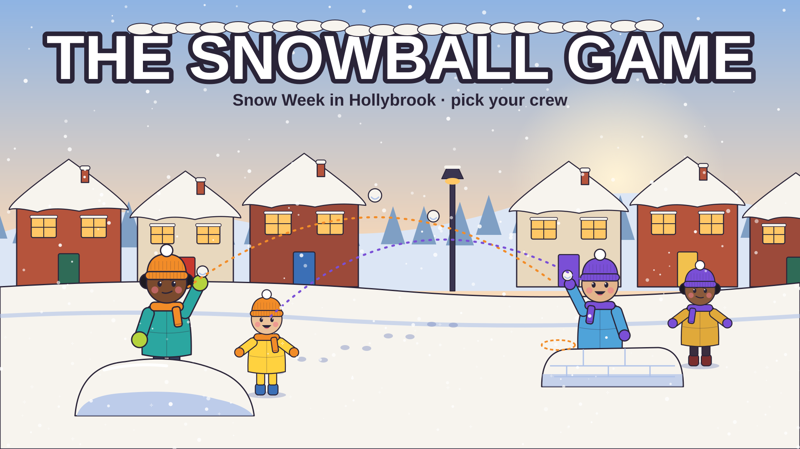
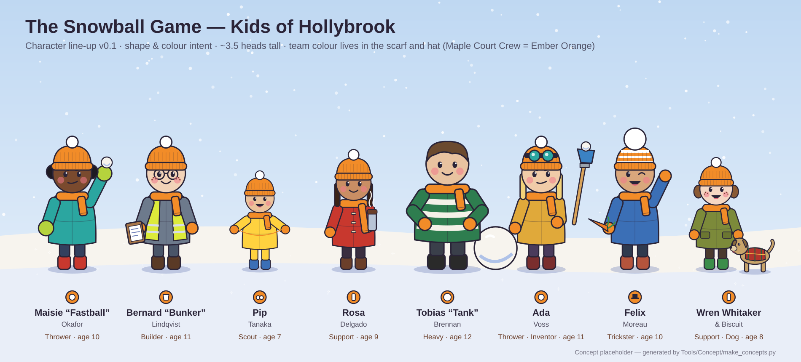

# The Snowball Game

School's closed, the snow is perfect, and the whole street is at war. Pick a
crew of four kids, each with a talent of their own, and out-throw, out-build
and out-think the gang from the next street over.

**Targets:** iOS and Steam (incl. Steam Deck) · **Engine:** Unity 6 (URP) ·
**Art pipeline:** Blender → Substance Painter → Unity

## Status

First playable greybox: a WEGO (planned simultaneous turns) prototype on the
Maple Court map, 4 v 4 against an AI crew. Open the project in Unity
6000.6.3f1, load `Assets/Scenes/MapleCourt.unity` and press Play.
How to play and how it's built: [Docs/Development/PROTOTYPE.md](Docs/Development/PROTOTYPE.md).

## Read first

- [Design vision](Docs/Design/GameDesignVision.md)
- [Play style options](Docs/Design/PlayStyle_Options.md)
- [Characters](Docs/Design/Characters.md)
- [Maps and environment](Docs/Design/Maps_and_Environment.md)
- [Art direction](Docs/Design/ART_DIRECTION.md)
- [Open questions](Docs/Development/OPEN_QUESTIONS.md)
